# Rivolt

  

> Free, open-source tracker for Rivian owners: what your Rivian actually
> costs. Charging cost at your own rate, trips, efficiency and lease miles.

**[Try the demo](https://demo.rivolt.dev)** (sample truck, no sign-in)
 · **[Use it at rivolt.dev](https://rivolt.dev)** (sign in with Google or GitHub)
 · **Self-host:** [docker compose](docker-compose.yml), [Helm chart](deploy/helm)
 · [Sign-up guide](docs/SIGNUP.md) · [MIT license](LICENSE)

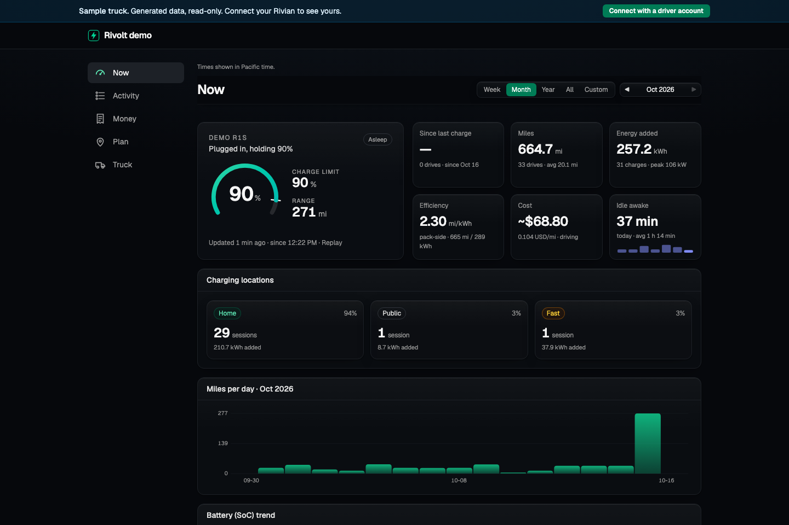

Rivolt is an **unofficial** companion app for Rivian vehicles. It is not
affiliated with, endorsed by or sponsored by Rivian.

## What it does

- **Every charge and trip priced at your rate**, with the source of each
  number shown (billed, home rate, network estimate, or entered by you).
- **Trip planner** that estimates what a road trip will cost, with weather
  and efficiency analysis.
- **Lease miles:** enter your allowance and term and see projected miles
  at lease return and the overage cost.
- **Efficiency** (mi/kWh) broken down by temperature, speed and drive mode.
- **Software update alerts** by push notification, with release notes.
- **Coming from ElectraFi?** Import your history from its CSV export; see
  [how](https://rivolt.dev/moving-from-electrafi).
- **Yours to keep:** export your data as a zip of CSVs (charges with cost source, drives,
  trips) or download a full JSON backup, delete your data
  from Settings, or run your own copy.

## Try the demo

**[demo.rivolt.dev](https://demo.rivolt.dev)** is a stable, read-only demo
on a *generated* sample truck: no sign-in, no Rivian account, and no
real vehicle data. Browse every tab below the way you would on your
own truck, and open the planner's sample trips to see a route with
charging stops. Or see a planned trip first: [Los Angeles to Las Vegas in two
days](https://rivolt.dev/sample-trips/la-las-vegas-two-days).

- The numbers are made up (a home-charging month at $0.16/kWh);
  yours will differ.
- Eight public, simulated trip plans need no sign-in at all:
  [rivolt.dev/sample-trips](https://rivolt.dev/sample-trips). Each lists every
  charging stop, the battery on arrival and departure, charge time and the
  estimated cost for a sample R1S, and opens in the demo planner.
- A public worked example and a calculator for what it costs to charge a
  Rivian at home, with no sign-in and nothing leaving your browser:
  [rivolt.dev/charging-cost](https://rivolt.dev/charging-cost). Every
  figure on it is an example.
- To use it with your own truck, sign up at [rivolt.dev](https://rivolt.dev)
  with Google or GitHub (the beta has an account cap); see
  [`docs/SIGNUP.md`](docs/SIGNUP.md). We recommend connecting an Authorized
  Driver account, so Rivolt never holds your primary Rivian login and you
  can revoke access from the Rivian app at any time.
- Rivolt uses Rivian's unofficial API, so it can break. It is read-only
  (it can't control your truck) and in beta.

---

## Five tabs

Rivolt is organised around five tabs: **Now**, **Activity**,
**Money**, **Plan** and **Truck**. Now, Activity and
Truck share one calendar scope (Day, Week, Month or a custom range,
with "This year" and "All time" inside Custom), Money steps month by month, and the app follows your system
light / dark setting (or the Appearance card in Settings).

### Now — the truck at a glance

The current state on one card: battery as an arc with the charge limit
marked on it, range, and whether the truck is parked, plugged in,
charging or driving (live frames while it moves, slower when parked).
Under it, the numbers for the scope you picked: miles since the last
charge, miles, energy added, efficiency, cost, and an Idle awake tile
that links to Truck. Below those, miles per day and a battery trend
with charging and driving shaded behind the line, so you can see why
the percentage moved.

- **Comfort line.** While the feed is live, one line reads what the truck
  says about the cabin: "Cabin 68°F · Pet mode on · Climate hold", or
  "Preconditioning". It disappears when the data is stale, so an old
  "Pet mode on" is never read as current.

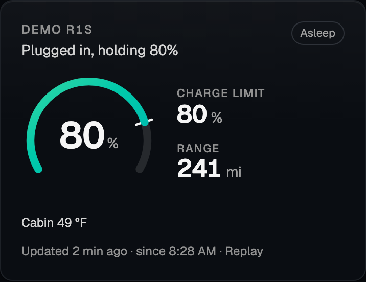

### Activity — every drive and charge

One day-grouped **Feed** of drives and charges, newest first, with
**Table** and **Map** views of the same rows (the map shows Drives or
Charges one layer at a time). Open any row for its detail page.

**Drives.** Distance, duration, average speed, energy used and cost.
The detail page draws the road-snapped route (self-hosted Valhalla over
a Protomaps basemap) coloured by speed, with time-aligned charts for
speed, SoC, elevation, temperature, headwind and precipitation, and
weather context for the drive's start hour from Open-Meteo when
enabled. A "Low GPS accuracy" pill appears when the modem returned
stale fixes or implausible jumps; its thresholds are admin-tunable.

**Charges.** Date, location, energy delivered, peak kW and cost. The
detail page has the power curve, peak and average kW, session
duration and, when the Parallax feed is available, the thermal split
between energy into the pack and energy spent on battery conditioning.
Sessions are bucketed Home / Public / Fast by clustering on coordinates
and peak kW; home sessions price against your configured home rate,
others against the cost Rivian reports.

- **Trailer connected.** Drives record whether a trailer was connected
  (from the connector, so "trailer", never "towing"), you can correct a
  drive, and efficiency figures leave those drives out and say so:
  "Excludes N drives with a trailer".
- **Estimated energy, marked.** If a Rivolt bug loses a charge's energy
  count, the kWh is worked out from the battery's change and shown as an
  estimate, "~12.3 kWh" with a note, and so is the cost that follows from
  it, on the feed, the charge page, Money's receipts, the month total, the
  statement email and the share card. Nothing estimated is ever shown as
  measured.

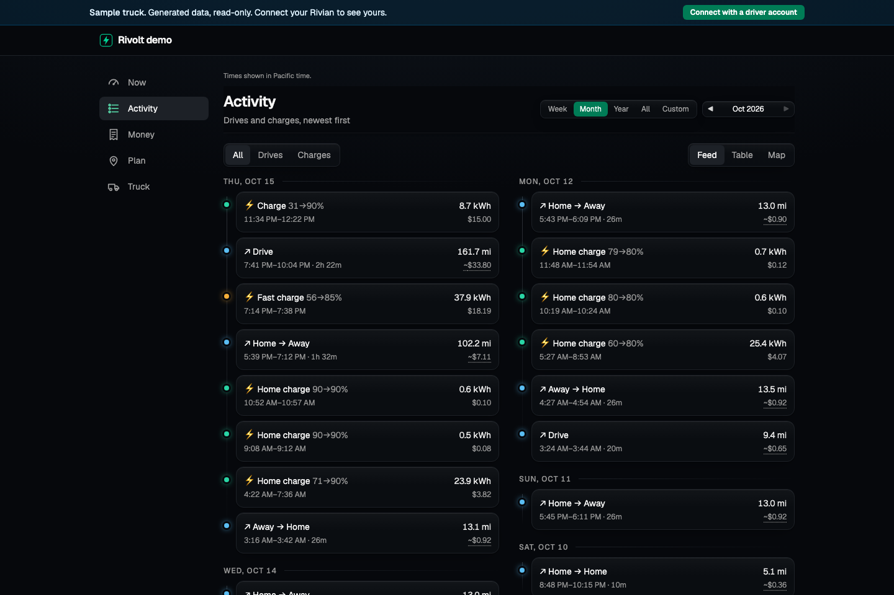

### Money — what charging actually cost

A monthly statement: spend for the month, how it compares with the
last one, and where the energy came from (Home, Away, DCFC) in dollars
or kWh. Receipts list every session with its price and where that price
came from, and anything estimated or unpriced is flagged rather than
guessed (with a one-tap way to add the price). "About these numbers"
spells out what is and is not included in the total.

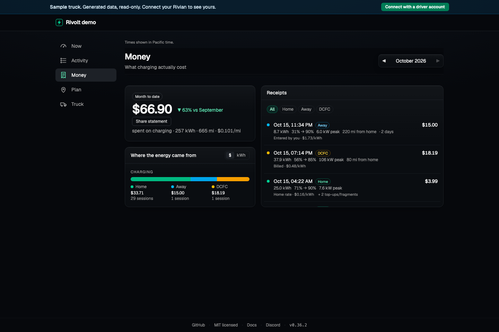

#### Off-peak hours and what moving charging would save

In Settings → Charging you can enter your off-peak hours yourself: several
windows, weekday and weekend splits, windows that run past midnight, a rate
for each, in your time zone. Rivolt uses them only for estimates; it does not
contact your utility and cannot check them. With a schedule and a home rate
set, Money shows an "Off-peak savings" card: what moving your home charging
into your cheapest window **could have saved, about $Y (estimate)**, from your
own home charges. Sessions that could not move are left out and the card says
how many. It is advice only: Rivolt never changes charging on the truck. A
share card can carry one extra line, the percentage of your home charging that
ran off-peak, behind its own switch that is off every time.

#### Month statement as a CSV

"Download CSV" on Money saves the month as a spreadsheet file: totals by cost
type, home versus away, and one line per session, in your time zone. It is
your own data, downloaded straight from your Rivolt; nothing is sent anywhere.

#### Share a month, a trip or a milestone

Any month, drive or milestone can become a square image you share from
your phone or save. It is made on your device and shows figures only:
no places, no map, no VIN and no dollars unless you switch on
"Include cost" for that card. Rivolt never uploads or posts the image.

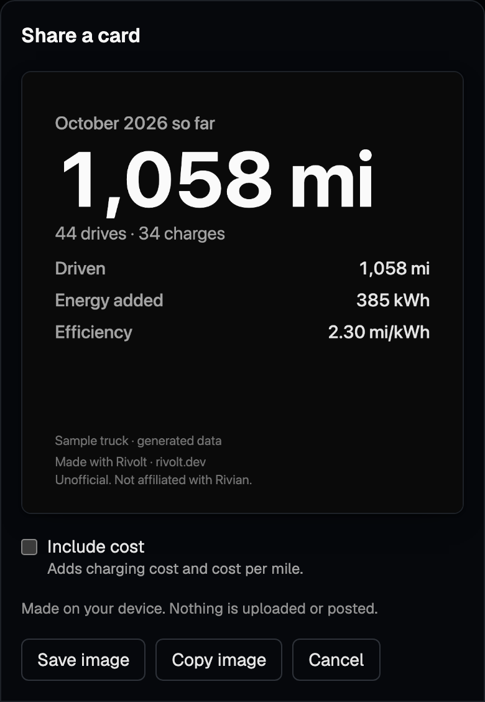

### Plan — a map-first trip planner

This is the feature the app was built for. On a computer the map fills
the right of the page and stays put while you work on the left; on a
phone the map is on top and the trip sits in a sheet you drag up.

- **Route bar.** From and To (with a swap button), departure, starting
  SoC on a slider, and a Plan button. Via-stops, target arrival SoC,
  drive mode and the adapter switch live under "More options".
- **Result.** Rivolt asks Rivian's own planner for a route with
  charging stops and shows arrival SoC, trip cost, time, distance and
  charging time, with alternatives as a compact chooser.
- **Itinerary.** Start, every charging stop and arrival as a vertical
  timeline. Open a stop for the charger and network, SoC in and out,
  charge time, energy and cost, and see it highlighted on the map (and
  the reverse).
- **Map.** Self-hosted Protomaps basemap with the route, plus a charger
  overlay along the route corridor (distance to the polyline, not a
  bounding box) with DCFC / L2 / Hotels filters from NREL AFDC data.
- **Cost.** Dollar figures come from your home rate, stop SoC deltas
  and each matched network's rate (your member rate where set), not
  from an LLM. When the operator wires an AI provider, short
  commentary on cost, efficiency, weather and the vehicle is added.
- **Saved trips and plan vs actual.** Save a plan and reopen it exactly
  as planned. After you drive it, Rivolt lines up each day's plan against
  what was recorded: arrival time, energy charged, cost and arrival
  battery, day by day.
- **Re-plan from here.** On a saved multi-day trip that's under way,
  re-plan the rest of it from the truck's current position and charge.
  The original plan is kept for comparison.
- **Avoid tolls, ferries or highways.** A per-trip setting that applies
  to every day and is saved with the trip. Avoiding highways usually adds
  time and can add a charging stop.

#### Multi-day trips

Going further than a day? Add an overnight and Rivolt plans each day
on its own: the start time, starting charge and arrival charge of each
day follow from the day before, including whatever charging happens
while you sleep.

- **Overnights are stops.** Each overnight sits in the itinerary with
  the arrival time and charge, the hours parked, the charger you expect
  there (Level 2 at 7 kW by default, another power, or none) and the
  charge you'll leave with, capped at the limit you set.
- **Hotels with Level 2.** The map's "Hotels with Level 2" filter shows
  hotels that list a Level 2 charger (NREL AFDC data). Pick one as the
  overnight and its listed power is used for the overnight estimate.
  Listed is not guaranteed: chargers can be in use, broken or
  guests-only, so check with the hotel before you rely on one.
- **Day by day.** Each day is its own section with its date, departure
  time, legs, charging stops and arrival charge. If a day can't be
  routed, the days before it are kept and the error says which day to
  fix.
- **Campgrounds.** On a long day, campgrounds with an electric hookup
  are suggested next to hotels (a "Campgrounds" chip and green pins on
  the map when the route has any). The outlet decides the planned power:
  a 50 A site is planned at 7.2 kW (estimate) with Rivian's Portable
  Charger, a 30 A site needs an adapter that isn't included with the
  truck and plans slow. Reservation is the campground's: listed, not
  guaranteed, and some parks don't allow EV charging, so ask first.
  Campground data: Recreation.gov (RIDB), CC BY 4.0; filtered by Rivolt.
- **Limits.** Up to 10 points per day (start, vias, end) and 10 days
  per trip.

Every figure in a plan is an estimate built from your own truck's
efficiency, the route and the chargers along it. Real charging speed,
weather and traffic will differ.

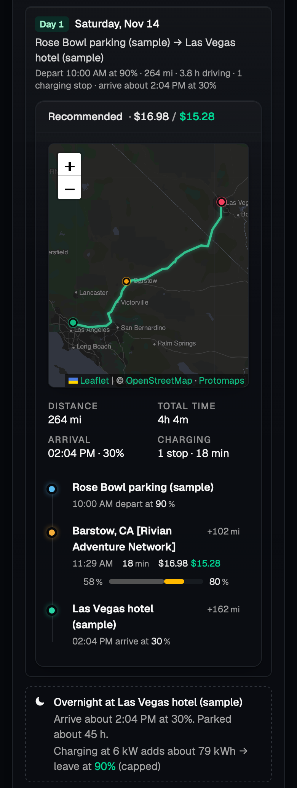

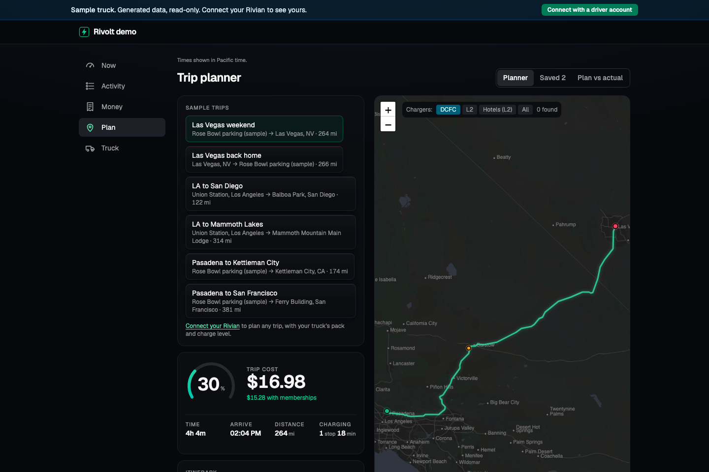

### Truck — health, sleep and drain

Parked drain, pack capacity and software version as the truck reports
them, plus three cards that read only what your own truck sends:

- **Tires.** Four pressures in psi and bar, front row first, with how old
  the reading is. A wheel is marked **Low** below 32 psi, or **Low (Rivian)**
  when the truck's own status says so; above that there is only the number,
  and Rivolt never calls a wheel OK. Your truck's correct pressure is on the
  placard on the driver's door.
- **Sleep health.** The sleep card now opens with this week against your
  truck's own last 30 days: "Nothing unusual this week" or "Woke N more times
  than usual this week", with the counts. It compares the truck only with
  itself, never with other trucks, and offers no cause (Rivolt's own
  requests, a key nearby or a fault can all wake a truck). Until there are
  five recorded days this week and fourteen in the baseline it says so
  instead of guessing.
- **Software update.** When the truck reports an update, the Vehicle card
  shows the version and the truck's own word for it: Downloading, Ready to
  install, Installing, with the reading's age. While it is installing and
  the feed is live, Now shows "Installing software 2026.38". No percentage
  yet (the scale is unconfirmed), no instruction, no alarm.

The sleep chart shows idle-awake time per day (the car awake while parked
and not charging), with a warning when it keeps waking up again within a
minute.

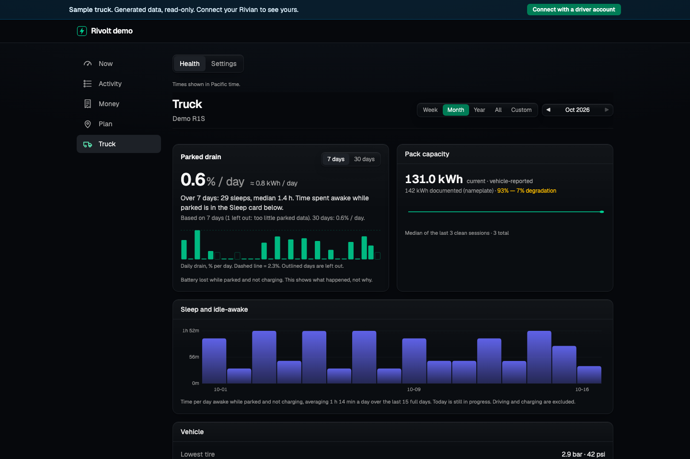

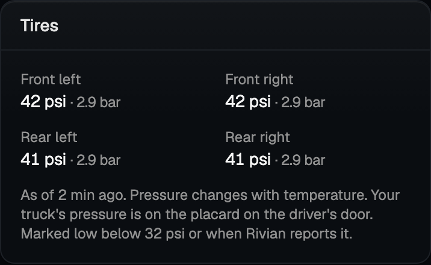
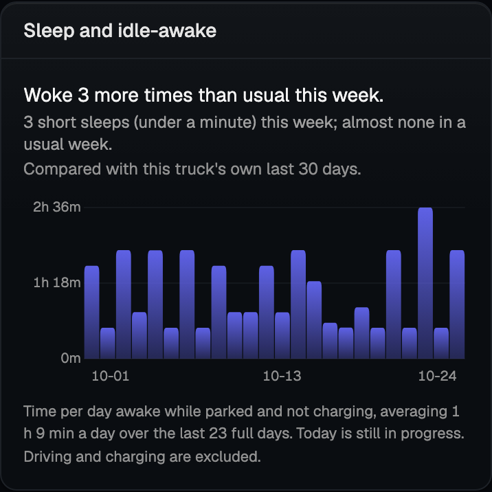

#### Trends

With enough history, Truck shows two trends for your own truck:
monthly efficiency (pack-side mi/kWh) and the usable pack capacity
estimated from your charges (not tracked on the R2 yet). Both come
from your recorded data only and are labelled estimates; they appear
once there is enough history to say anything, and never compare you
with other owners.

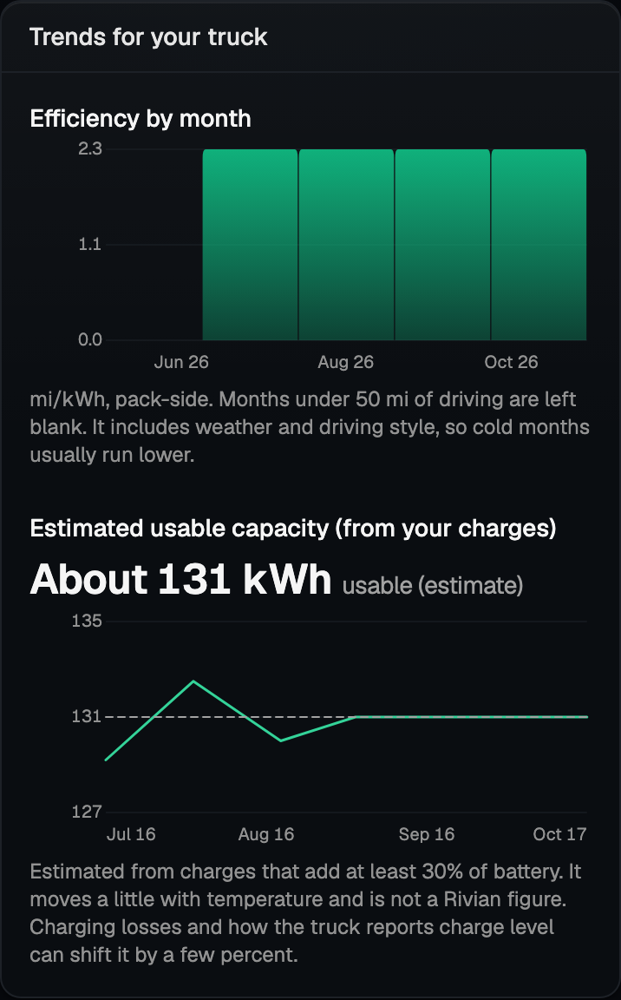

#### Range near a temperature

From your own drives and the weather data recorded with them, Rivolt
shows the range band your truck has actually delivered near a given
outside temperature, so a cold morning is not a surprise. It is a
summary of your history, not a forecast, and it needs at least 5
drives and 50 miles near that temperature before it shows.

#### Parked drain, asleep or awake

The parked-drain card splits each loss by when it happened: while the
truck was asleep or while it was awake. Both figures are estimates
from the readings the truck sent while parked.

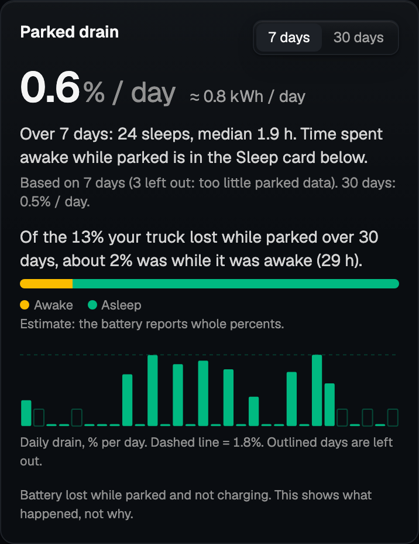

### On a phone, and in light

The same tabs work at phone width, and the main tabs have a light theme.

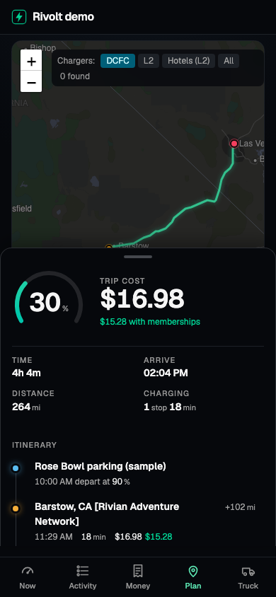 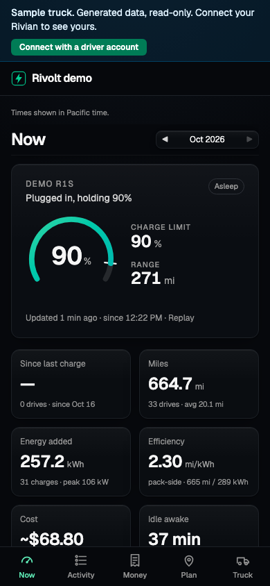

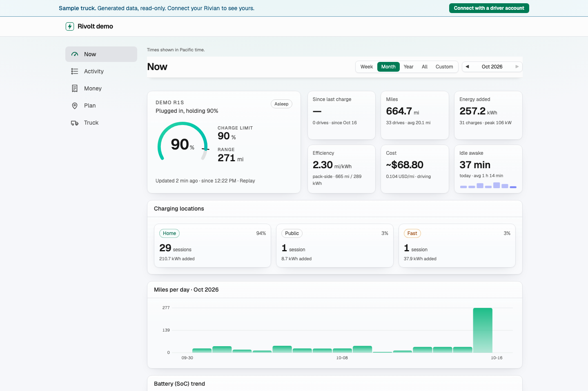

---

## Rivolt on iPhone (TestFlight)

A native iPhone app is in internal testing. Access is **by invitation from the
maintainer through TestFlight**, with no public link and no App Store listing
yet, so most people will use the web app above for now.

What it does today:

- **Now** — charge level, range, what the truck is doing and how fresh that
  is, with a switcher when you have more than one truck.
- **Widgets** — charge and range on the Home Screen and the Lock Screen. A
  widget that can't refresh says how old its numbers are instead of looking
  current.
- **Notifications** — charging complete, software updates and anomalies, plus the
  plug-in reminder and milestones if you turn them on in Settings on rivolt.dev.
  Apple's push service sees only your phone's push address and a generic 'Rivolt update'; the words are fetched from Rivolt when it arrives.

Signing in uses a browser sheet on **rivolt.dev**, the same sign-in as the web
app, followed by one confirmation page ("Sign in to the Rivolt iPhone app?":
tap Continue), so the app never sees your password and keeps only a revocable
session token in the iPhone Keychain. Signing out removes it, and you can revoke it from the web.
The app is read-only like the rest of Rivolt: it never sends anything to your
truck.

If you run your own server, "Other server" on the sign-in screen accepts an
https address and checks that it is a Rivolt server; your server turns app
sign-in on with `RIVOLT_APP_CALLBACK_URL=rivolt://auth`. Notifications from the
App Store build come only from rivolt.dev, since they need Rivolt's own Apple key.

See [`ios/README.md`](ios/README.md) for how it is built and tested.

---

## Settings — everything in one place

A five-tab layout for the per-user controls:

- **Account** — Rivian connection (with the optional dedicated
  Authorized Driver setup documented in
  [`docs/SIGNUP.md`](docs/SIGNUP.md)).
- **Vehicle** — vehicle profile (pack capacity), display units,
  home location.
- **Charging** — home $/kWh rate + currency, your off-peak
  schedule, preferred public networks (with each network's
  membership plans as it lists them, its source and the date it was
  last checked), trip planner defaults.
- **Notifications** — per-device push subscription with per-event
  toggles (see below).
- **Data** — ElectraFi CSV import + danger zone (full JSON
  backup, reset).

---

## Notifications — web push

Web Push (VAPID), per-device subscribe. Enable once on each
device you want pinged, pick which events you care about, and
Rivolt delivers an OS-level notification on the next matching
event. Currently wired: **charging session completes** (with the
final SoC + kWh added in the body). Plug-in reminders and
anomaly alerts have the plumbing — event sources land next.

- **Left open (opt-in, off by default).** A push to web push and the iPhone app when a door, the frunk,
  the liftgate, the tailgate or the tonneau has been open for 15 minutes
  after the truck is parked and left: "The frunk and a door on your R1S
  have been open for 15 minutes." Windows are not included. One alert per
  episode, and it can be missed if the truck is offline. It says nothing
  about safety; it only tells you something is open.

---

## Sign up

See [`docs/SIGNUP.md`](docs/SIGNUP.md) for an end-to-end walkthrough
of:
- signing up directly,
- connecting your Rivian account (with the dedicated Authorized
  Driver account approach we recommend),
- importing your history from ElectraFi,
- configuring your home charging cost,
- planning your first trip.

---

## Your first day

A new account gets a short card on Now: set your home rate, add a
lease, turn on alerts. The first recorded charge becomes a card with
its kWh and cost at your rate, and a one-time card points at three
things most people haven't switched on: charge-done notifications,
the lease tracker and the monthly statement email. Setup reminders by
email stop as soon as Rivolt has data from your truck, and every
reminder email has a one-click unsubscribe.

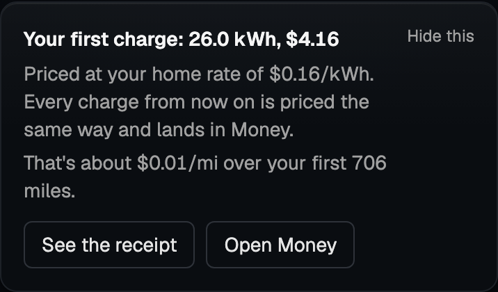
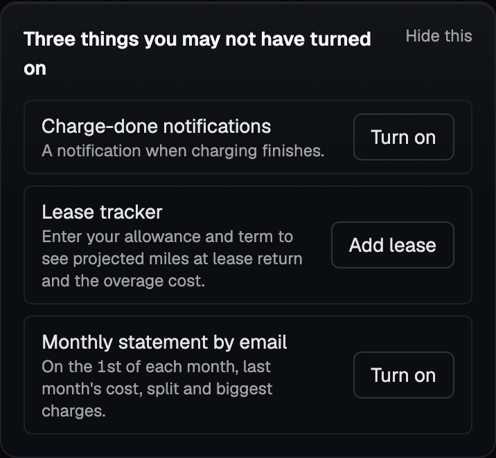

---

### What's checked on the R2

Rivolt supports the R2. This is exactly what has been confirmed on
real R2s, so you know what to trust.

- **Checked on real R2s:** drives · charges and plug-in · charge limit
  · battery, range and odometer · location · cabin and battery
  temperature · tire pressure · sleep and park state (since the
  October fix the R2 reports its power state on nearly every reading, so
  sleep, standby and parked show as they do for an R1) · reported
  battery capacity. Sleep health still needs 14 baseline days, so an R2
  reads "Not enough history yet" until it has them.
- **Shown as an estimate:** time to full charge (Rivian's own
  countdown, labelled "estimate"). Power state can take a minute to
  appear after Rivolt reconnects.
- **Not on the R2 yet:** trip charge target · why a charge stopped ·
  camp and pet modes · Rivian's parked-energy breakdown ·
  smart-charging status. Each appears once it has been confirmed on an
  R2.

Outside temperature doesn't come through for any truck; Rivolt can
look it up from weather data if you turn that on (off by default).
Something looks wrong on your R2?
[Open an R2 report](https://github.com/apohor/rivolt/issues/new?template=r2-report.yml):
no VIN or location needed.

---

## Data ownership

- Your Rivian credentials are AES-GCM sealed and decrypted only
  in-memory at request time. Disconnect Rivian in one click.
- AI features (when enabled by the operator) are powered by an
  install-wide provider — OpenAI, Anthropic, or Google Gemini —
  configured from the admin UI. Each user's drive / trip context
  is sent to that provider only at the moment a recap or trip
  analysis is generated; nothing is mirrored to a third-party
  service in between.
- All your drive, charge, and trip data is exportable as JSON from
  Settings → Data, and deletable from the same page.
- **Read-only against the Rivian API.** Rivolt sends commands to
  no Rivian endpoint, period. It can't unlock doors, start
  charging, or change drive mode. Telemetry only.

---

## Stack

- **Single Go binary + embedded SPA.** Distroless multi-arch
  container image; the same binary serves API + static assets.
- **Go 1.25**, chi router, pgx-backed `database/sql`,
  coder/websocket for the Rivian feed, webpush-go for VAPID.
- **Postgres** with Row-Level Security, monthly partitioning on
  `vehicle_state`, envelope-encrypted secrets in `user_secrets`.
  Multi-tenant from day one: every data-plane store carries
  `user_id`, every query filters on it, every request pins
  `app.user_id` so RLS does the final enforcement at the DB.
- **React 19 + TypeScript + Vite + Tailwind v4** for the SPA;
  TanStack Query for the data layer; uPlot for time-series
  charts; Leaflet + protomaps-leaflet for maps.
- **Optional AI providers** — OpenAI, Anthropic, or Google Gemini,
  selected install-wide by the operator from the admin UI.
  Hot-swappable; calls go to the chosen provider only when an AI
  feature actually runs (trip analysis, drive recap).
- **Optional street-level address search.** Set `RIVOLT_PHOTON_BASE_URL`
  to a [Photon](https://github.com/komoot/photon) geocoder to search home
  and trip locations by street address. Without it, trip and place search
  is city-level (via Open-Meteo) and the home address field is hidden;
  home can still be set from a charge's location or by coordinates.
  Self-host Photon (it serves OpenStreetMap data), e.g.
  `http://photon.photon.svc.cluster.local` in-cluster, or point it at
  komoot's public server `https://photon.komoot.io`, which Rivolt is
  compatible with (it calls `/api/?q=`). With the public server every
  search, including a home address a user types, is sent to komoot, who
  ask for fair, light use and guarantee nothing.

---

## Status

In production at [rivolt.dev](https://rivolt.dev). The demo at
[demo.rivolt.dev](https://demo.rivolt.dev) runs on generated data, and
a preview at [preview.rivolt.dev](https://preview.rivolt.dev) tracks
`main`.

Release notes for every version are at
[rivolt.dev/changelog](https://rivolt.dev/changelog), with an Atom feed at
[`/changelog.atom`](https://rivolt.dev/changelog.atom), and on the
[GitHub releases page](https://github.com/apohor/rivolt/releases). The
version in the app's footer links to its release on GitHub.

See [`docs/ROADMAP.md`](docs/ROADMAP.md) for what's queued and
[`docs/ARCHITECTURE.md`](docs/ARCHITECTURE.md) for the load-bearing
design decisions.

---

## License

Core is MIT-licensed. Some future add-ons may ship under a separate
commercial license; details will be published alongside each add-on.

## Legal

"Rivian" is a trademark of Rivian Automotive, Inc. Rivolt is an
independent, community-built project with no affiliation to,
endorsement by, or partnership with Rivian. Reference to Rivian is
for descriptive purposes only.

Use at your own risk. Rivolt relies on unofficial access to Rivian's
APIs and may break at any time.
